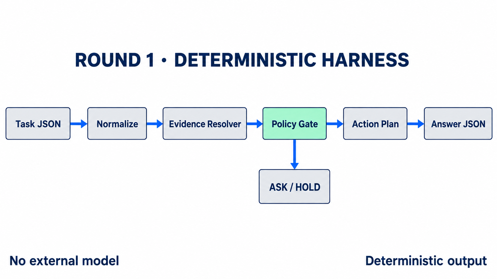

# 예선 1차: 결정적 에이전트 하네스

예선 1차에서는 task JSON에 담긴 상태와 기록을 해석해 answer JSON을 생성하는 에이전트 하네스를 구현했습니다. 외부 모델이나 네트워크 API 없이 Python 표준 라이브러리만 사용하며, 같은 입력에는 항상 같은 결과를 반환합니다.

## 결과

- Public leaderboard 최고 점수: `0.8964`
- 최종 순위: 640명 중 37위
- 결과: 예선 2차 진출

Public 순위는 시점에 따라 변동되어 기록이 일치하지 않으므로 이 문서에서는 별도로 주장하지 않습니다.

## 아키텍처

<p align="center">
  
</p>

입력 JSON을 정규화한 뒤 최신 상태와 기록에서 판단 근거를 찾고, 정책 경계를 통과한 행동만 계획에 반영합니다. 근거가 부족하거나 충돌하면 `ASK` 또는 `HOLD`로 빠지며, 같은 입력은 항상 같은 answer JSON으로 변환됩니다.

## 파일 구성

```text
round1/
├── code/
│   ├── harness.py   # 상태·정책·행동을 결정하는 핵심 로직
│   ├── run.py       # 입력 로드, 실행, 검증과 CSV 생성
│   └── slm.py       # 외부 모델을 호출하지 않는 로컬 보조 신호 추출기
└── data/
    └── README.md    # 비공개 입력을 포함하지 않는 이유와 배치 방법
```

## 설계 원칙

### 입력 근거를 우선합니다

task ID나 문항별 정답표를 사용하지 않습니다. 기기 상태의 record와 object, 대화 기록, 세션 메모에 포함된 근거를 해석해 focal target, control, content scope, policy와 plan event를 결정합니다.

### 현재 상태를 우선합니다

배열 위치만 믿지 않고 명시적인 turn을 기준으로 대화 기록을 정렬합니다. 같은 대상에 대한 기록이 여러 개라면 최신 상태와 해결된 대상을 우선하고, 오래된 정보가 현재 결정을 덮어쓰지 않도록 했습니다.

### 불확실하면 실행하지 않습니다

대상이나 승인 경로가 불분명하거나 기록이 충돌하면 임의의 행동을 만들지 않습니다. 이 경우 확인 요청 또는 보류 상태를 반환해 사용자가 다시 판단할 수 있도록 합니다.

### 비정형 입력을 안전하게 처리합니다

누락 필드, 예상과 다른 JSON 타입, 새로운 값, 입력 순서 변경을 정규화합니다. 구조·타입·ID·순서를 변형한 34,299건의 퍼즈 테스트에서 예외와 출력 스키마 위반이 발생하지 않았습니다. 이 검증은 실행 강건성을 확인한 것이며, 비공개 정답에 대한 정확도를 보장하는 의미는 아닙니다.

## 실행 방법

Python 3.10 이상이 필요하며 별도 패키지는 설치하지 않습니다. 참가 권한으로 받은 입력 파일을 다음 위치에 둡니다.

```text
round1/data/tasks.jsonl
```

저장소 루트에서 다음 명령을 실행합니다.

```bash
python -S round1/code/run.py submit
```

생성 결과는 다음 위치에 저장됩니다.

```text
round1/output/submission.csv
```

실행기는 task ID 중복, answer key 집합, CSV 구조와 JSON round-trip을 다시 확인한 뒤 결과를 저장합니다.

## 재현 범위

공식 task와 정답은 이 저장소에 포함하지 않았습니다. 따라서 공개 저장소만으로 대회 점수를 재현할 수는 없지만, 최종 제출에 사용한 판단 코드와 출력 생성 경로는 그대로 보존했습니다.
