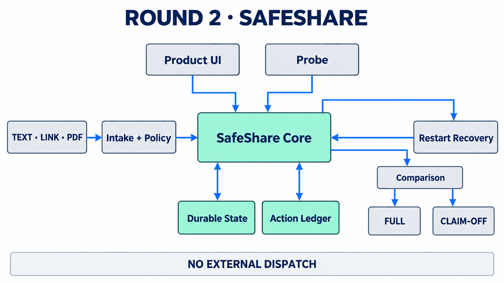
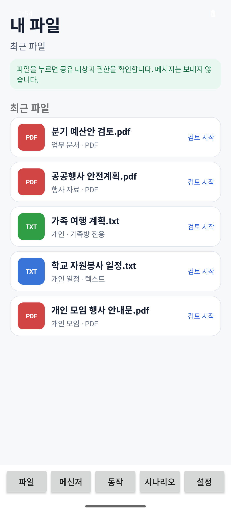
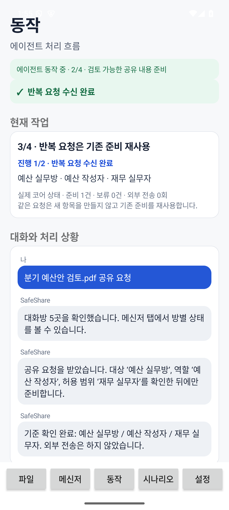
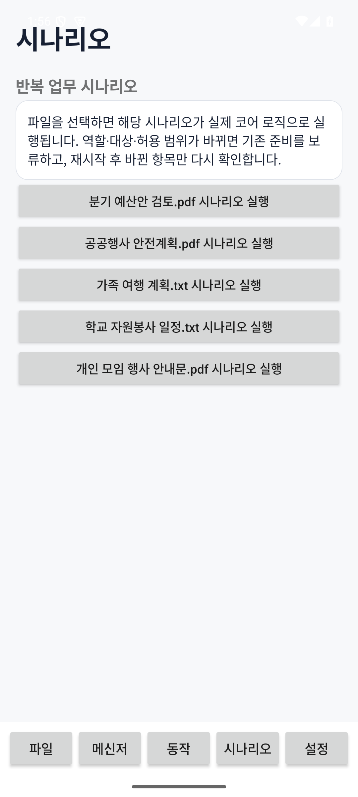
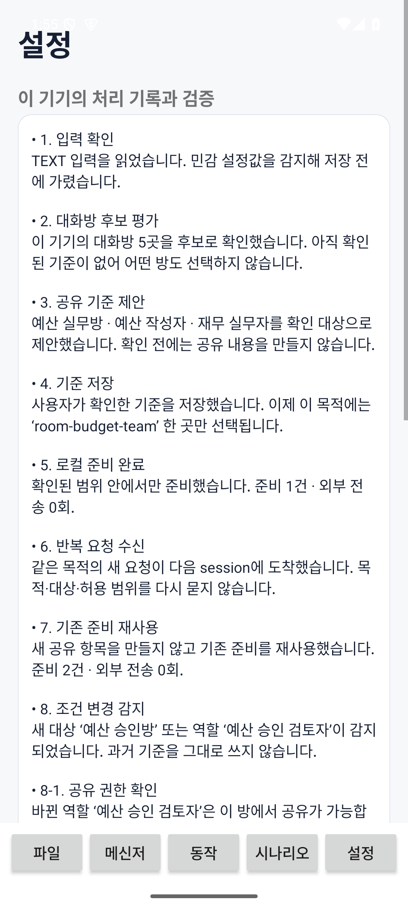

# 예선 2차: SafeShare

`SafeShare`는 사용자가 파일을 공유하기 전에 목적, 대상 대화방, 현재 역할과 허용 범위를 확인하고, 확인된 맥락을 다음 세션에서 안전하게 재사용하는 Android Mobile Agent입니다. 조건이 달라지면 전체 상태를 초기화하지 않고 영향을 받은 초안만 보류·취소·재계획합니다.

예선 2차 제출은 완료했지만 본선에는 진출하지 못했습니다. 이 디렉터리에는 최종 제출 `SOURCE.zip`의 소스와 재현 문서를 보존했으며, APK·서명 자료·평가 evidence는 포함하지 않았습니다.

## 아키텍처

<p align="center">
  
</p>

제품 UI와 평가용 Probe는 동일한 `SafeShareCore`를 사용합니다. 코어는 durable state와 action ledger를 함께 관리하며, 프로세스가 다시 시작되면 달라진 의존성만 복구합니다. 비교 모드는 같은 snapshot을 `FULL`과 `CLAIM-OFF`로 분리해 실행하므로 두 실행의 상태가 섞이지 않습니다.

## 사용자 흐름

1. **E1 Learn**: TEXT, LINK 또는 PDF를 검토하고 목적, 대상, 현재 권한과 허용 범위를 확인합니다.
2. **E2 Reuse**: 확인된 route와 안정적인 사실만 재사용해 app-local 공유 초안을 만듭니다.
3. **E3 Exception**: room, role, scope 또는 link 접근 조건이 달라지면 영향을 받은 초안만 `HELD`로 저장하고 프로세스를 종료합니다.
4. **E4 Recover**: 새로운 프로세스에서 checkpoint를 읽고, 달라진 의존성만 취소·재계획한 뒤 사용자 확인으로 복구합니다.

## 실제 앱 화면

최종 제출 `APP.apk`를 Android 15/API 35 에뮬레이터에서 직접 실행해 캡처했습니다. 표시된 파일명, 대화방과 처리 기록은 실제 개인정보나 대회 비공개 데이터가 아닌 합성 예시입니다.

<table>
  <tr>
    <td align="center"><br><sub><b>파일 선택</b></sub></td>
    <td align="center"><br><sub><b>기준 확인과 재사용</b></sub></td>
    <td align="center"><br><sub><b>반복 업무 시나리오</b></sub></td>
    <td align="center"><br><sub><b>처리 기록과 검증</b></sub></td>
  </tr>
</table>

## 핵심 구현

- `SafeShareCore.kt`: fact, route, draft, action, outcome과 tombstone을 관리하는 durable reducer
- `SafeSharePolicy.kt`, `SafeShareIntake.kt`: secret 가림, link 확인과 bounded PDF intake
- `ProcessRestartProtocol.kt`: 실제 process 종료·재실행과 checkpoint 복구
- `SafeShareComparison.kt`: 같은 snapshot을 격리된 `full`·`claim-off` namespace에서 실행하는 비교 모드
- `RunEvidenceArchive.kt`: event, action, outcome과 receipt를 한 run에 결박하는 evidence archive
- `ScenarioParser.kt`, `ScenarioExecutor.kt`: 합성 시나리오를 production core에 실행하는 parser와 executor

핵심 메커니즘은 **확인된 route 재사용과 dependency-scoped recovery**입니다. 조건이 바뀌었을 때 모든 맥락을 버리는 대신, 실제로 영향을 받은 초안과 의존성만 다시 확인합니다.

## 안전 경계

- 실행 중 LLM, 외부 모델과 백엔드를 사용하지 않습니다.
- 실제 메시지 발송, 결제, 게시와 외부 dispatch를 수행하지 않습니다.
- Android standard permission을 요청하지 않습니다.
- 삭제한 원문은 tombstone으로 막아 재실행이나 replay 이후 다시 사용되지 않도록 했습니다.
- OFFLINE, DELAYED, UNKNOWN 상태를 완료로 표시하지 않고 `WAIT`, `ASK` 또는 `ABSTAIN`으로 구분합니다.

## 검증

최종 제출 당시 다음 항목을 확인했습니다.

- 20개 테스트 스위트, 139개 단위 테스트 통과
- 별도의 holdout 24개 시나리오, 96개 episode와 312개 action 통과
- 중복·역순 event, 지연 outcome, 정정·철회·삭제와 실제 process restart 검증
- 14개 APK 입력 시나리오와 완전 합성 PDF 3개 사용
- production APK에 oracle, expected state, answer와 score 자산이 없음을 확인
- 외부 dispatch와 실행 중 모델 호출 모두 0회

## 디렉터리 구성

```text
round2/
├── SOURCE_BUILD_README.md
├── app-code/
│   ├── candidate_app/       # Android 앱과 unit test
│   └── tools/               # 합성 데이터 생성기와 release 검사 도구
└── 관련자료/
    ├── 연구/데이터/         # 합성 데이터 provenance와 data card
    └── 대회_제출_문서/      # third-party notice
```

## 빌드

Android SDK Platform 35, Build Tools 35.0.0과 JDK 17이 필요합니다. 공식 Probe 연동을 포함해 빌드하려면 대회 Kit의 starter AAR를 다음 위치에 직접 배치해야 합니다.

```text
round2/app-code/candidate_app/app/libs/scpc-probe-starter-3.0.0-draft.aar
```

starter AAR는 대회 제공물이므로 이 저장소에서 재배포하지 않습니다. 합성 데이터 생성과 전체 빌드 명령은 [SOURCE_BUILD_README.md](SOURCE_BUILD_README.md)에 정리했습니다.

## 참고

앱은 Android 15/API 35 평가환경을 기준으로 검증했습니다. `minSdk 28`은 manifest 하한값이지만, API 30 이상인 edge-to-edge API를 사용하므로 API 28·29 지원을 주장하지 않습니다.
